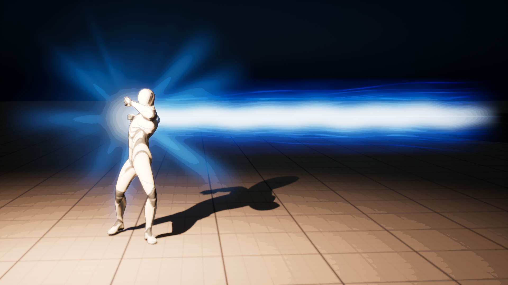

# One shot, built from script

A single Unreal Engine 5.7 cinematic shot in a cel-shaded register: a character
braces, charges and fires an energy blast. Staged in Sequencer, drawn through a
toon post-process pass, rendered with Movie Render Queue.

Nothing in this project was assembled by hand in the editor. The level, the
lights, the camera move, the animation timing, the render settings and the
render itself are four Python scripts and one command.



The clip itself is [shot.mp4](shot.mp4), 45 frames at 30 fps.

## The shot

1.5 seconds, 45 frames at 30 fps, 1920x1080, rendered through Movie Render Queue
with a deferred pass and one temporal sample. The character braces, an energy core
builds at his hands, it releases, the beam carries across the frame.

Four scripts build the level, the lights, the camera move with its kick on the
flash, the animation timing, the toon pass and the render settings. A fifth tool,
written in Swift because there is no ffmpeg on this machine, turns the frames into
a clip. The editor is never opened by hand.

`build_look_sequence.py` is the one that saved the most time: it makes a throwaway
sequence where the camera jumps between six candidate angles every six frames, so
one render answers six framing questions instead of six renders answering one each.

The toon look is a post-process material built from script: scene colour, depth
and world normal are sampled through SceneTexture nodes, the edge comes from
comparing a pixel with its right and lower neighbours in depth and in normal, and
the fill is quantised into five steps with a gamma lift so the shadows do not
collapse into black.

## What is ours and what is not

| Part | Where it comes from |
|---|---|
| The effect, `Content/EnergyBeamV2` | Ours. Niagara system built from Python, materials written as HLSL, no textures |
| The shot: level, sequence, toon pass, render config | Ours, in `scripts/` |
| Character and the grey blocks | Epic, shipped with the engine templates. Not redistributed here |

## Rebuild it

The Epic content is not in this repository. Copy it from the engine first:

```
cp -R "/Users/Shared/Epic Games/UE_5.7/Templates/TemplateResources/High/Characters/Content/" CinematicShot/Content/Characters/
cp -R "/Users/Shared/Epic Games/UE_5.7/Templates/TemplateResources/High/LevelPrototyping/Content/" CinematicShot/Content/LevelPrototyping/
```

Then build the shot and render it:

```
UE=/Users/Shared/Epic\ Games/UE_5.7/Engine/Binaries/Mac/UnrealEditor-Cmd
P=CinematicShot/CinematicShot.uproject
"$UE" "$P" -run=pythonscript -script=scripts/build_scene.py -unattended -nosplash
"$UE" "$P" -run=pythonscript -script=scripts/build_sequence.py -unattended -nosplash
"$UE" "$P" -run=pythonscript -script=scripts/build_toon.py -unattended -nosplash
"$UE" "$P" -run=pythonscript -script=scripts/build_render_config.py -unattended -nosplash
"$UE" "$P" /Game/Shot/L_Shot -game -MoviePipelineLocalExecutorClass=/Script/MovieRenderPipelineCore.MoviePipelineInProcessExecutor -MoviePipelineClass=/Script/MovieRenderPipelineCore.MoviePipeline -LevelSequence=/Game/Shot/LS_Shot -MoviePipelineConfig=/Game/Shot/MRQ_Config -unattended -nosplash
```

Frames land in `render/`. There is no ffmpeg on this machine, so
`scripts/frames_to_mp4.swift` turns them into a clip with AVFoundation:

```
swiftc -O scripts/frames_to_mp4.swift -o scripts/frames_to_mp4
scripts/frames_to_mp4 render shot.mp4 30
```

## One trap worth knowing

Movie Render Queue's temporal sample count multiplies how fast a Niagara system
runs. With `temporal_sample_count = 4` the charge, the flash and the beam were
all over in 14 frames instead of 58: the system ticks once per sub-sample at the
full frame delta, so the simulation runs four times faster while the camera and
the character animation keep correct time. The render here uses one temporal
sample for that reason, and lets TSR do the anti-aliasing.
